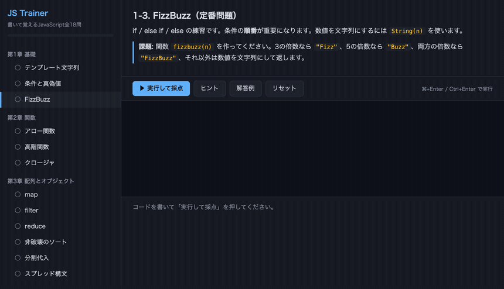

# JS Trainer — 書いて覚えるJavaScript

読むだけでは書けるようにならないので、**書いて、即採点して、次へ**進むだけのドリル。
1問ごとにテストが走り、通らなければ何が期待値と違うのかがその場で出ます。



**▶ その場で試す: https://npulsar-droid.github.io/js-trainer/**

**単一HTMLファイル・依存ゼロ・ビルド不要。** ダウンロードしてダブルクリックでも動きます。

## 全5章18レッスン

| 章 | 内容 |
|---|---|
| 第1章 基礎 | テンプレート文字列 / 条件と真偽値 / FizzBuzz |
| 第2章 関数 | アロー関数 / 高階関数 / クロージャ |
| 第3章 配列とオブジェクト | map / filter / reduce / 非破壊のソート / 分割代入 / スプレッド構文 |
| 第4章 非同期処理 | Promiseを作る / async・await / Promise.all |
| 第5章 DOM操作 | 要素の生成 / 配列→リスト表示 / イベント処理（卒業課題） |

## 使い方

課題を読んで、エディタに関数を書いて実行するだけです。

- **採点はブラウザの中だけ**で完結します。サーバも通信もありません
- 詰まったら「ヒント」、それでもだめなら「解答例」。見ても減点はありません
- 書いたコードは自動保存されます（localStorage）。閉じても続きから

非同期の課題には3秒のタイムアウトがあるので、`await` を忘れて固まっても画面が死にません。
DOM操作の課題は、その場で作った要素に対して検証するので、ページ本体は汚れません。

## 動かす

そのまま開くだけです。

```bash
open index.html   # macOS（Windows は start index.html、Linux は xdg-open index.html）
```

ローカルサーバ経由でも動きます。

```bash
python3 -m http.server 8642
# → http://localhost:8642/ を開く
```

> **注意**: `file://` で開いた場合と `localhost` で開いた場合では、
> ブラウザの localStorage の保存先が別になります。進捗を続けたいなら開き方を統一してください。

## 技術

- 採点: `new Function` で書いたコードを評価し、各レッスンのテストを実行
- 保存: localStorage
- 外部ライブラリなし
- 自己テスト: `node test.mjs`（依存なし。全問の模範解答が採点を通るか、初期コードが通らないかなどを確認）

## ライセンス

MIT
